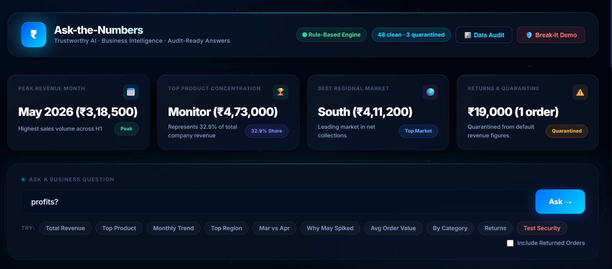
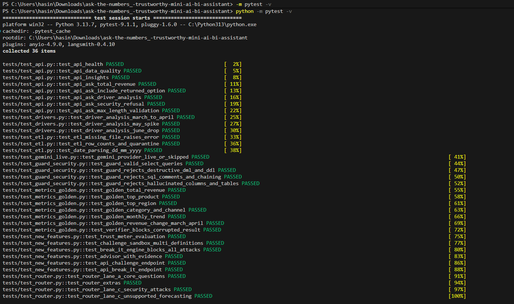
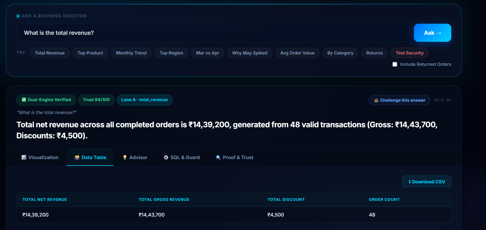
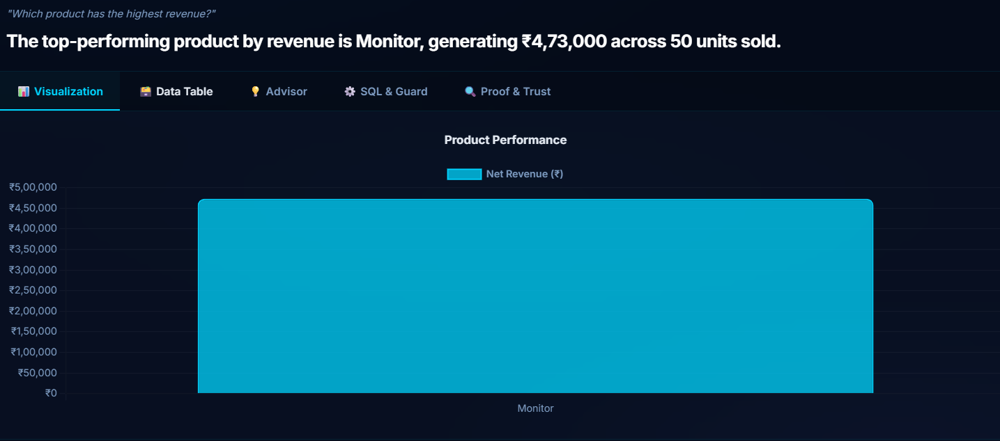
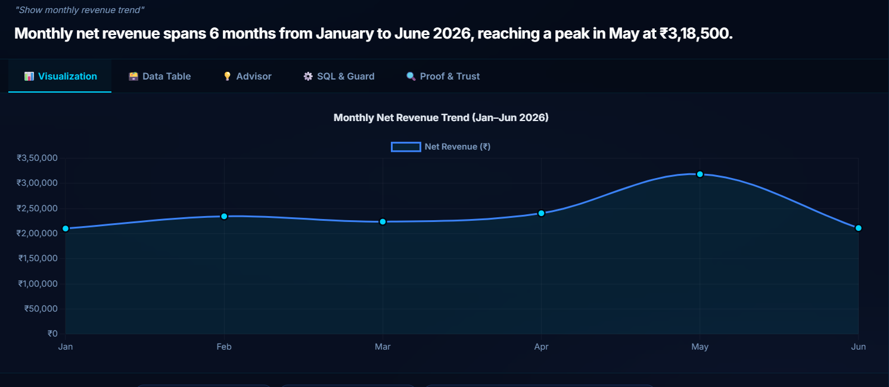
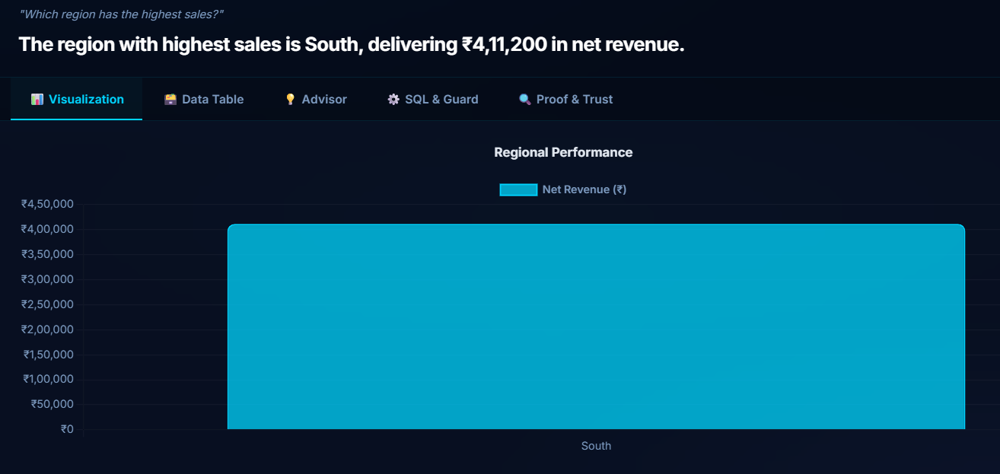
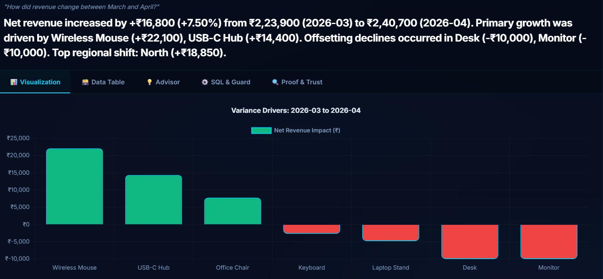
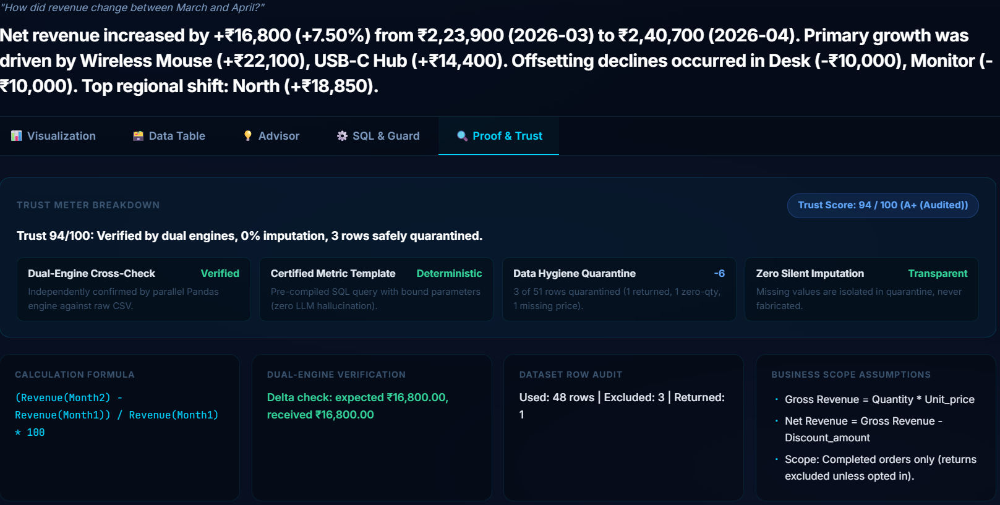
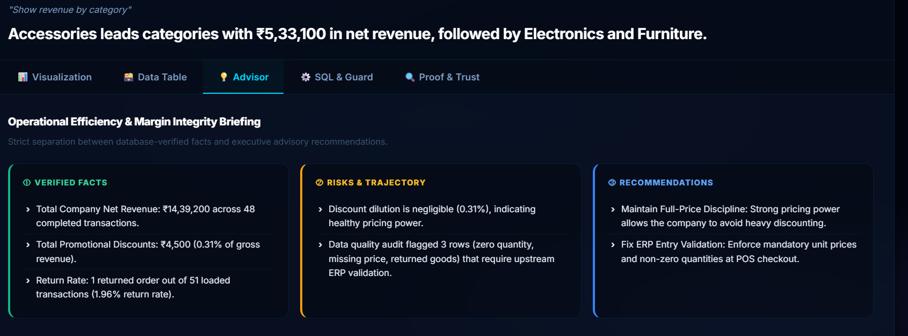
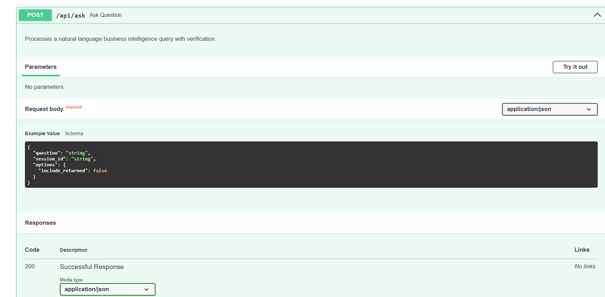

# Ask-the-Numbers: A Mini Business Intelligence Assistant

I built this for RSG's Graduate Engineer Trainee development challenge. You type a question about the sales data in plain English and get an answer you can check. Every answer comes with the exact SQL behind it, the rows it was built from, a trust score, and a note on which records were left out and why.

The idea I kept coming back to while building it: **the language model never does the maths.** It only helps work out what you are asking. Every figure comes from a database query, and a second, independent calculation in Pandas has to agree before an answer is marked Verified.


*The home page. The header shows the active engine (Rule-Based Engine here) and the row counts (48 clean, 3 quarantined). Below it are the headline cards, the question box, the example questions and the Include Returned Orders option.*

## What it does

- Loads the sales CSV into SQLite and keeps a record of the rows that have problems.
- Answers the five challenge questions: total revenue, top product, monthly trend, top region, and revenue change between two months.
- Explains what drove a change between two months, by product and by region.
- Answers a few related questions, such as revenue by category, average order value and returns.
- Shows the SQL, the result table, the formula, the assumptions and a trust score for every answer.
- Lets you challenge an answer, which shows it under other definitions.
- Includes a Break-It Demo that sends attack-style requests and shows them being blocked.
- Refuses destructive or unsupported requests and says why.
- Runs with no API key. If a Gemini key is set, it also handles open-ended questions through guarded text-to-SQL.

## Run it

You need Python 3.11 or newer. I ran it on Python 3.13.

**Windows (PowerShell)**
```
git clone https://github.com/<your-username>/<your-repo>.git
cd <your-repo>
python -m venv .venv
.venv\Scripts\activate
pip install -r requirements.txt
python -m app
```

**Mac / Linux**
```
git clone https://github.com/<your-username>/<your-repo>.git
cd <your-repo>
python3 -m venv .venv
source .venv/bin/activate
pip install -r requirements.txt
python -m app
```

Then open http://localhost:8000. The CSV is read from `data/ai_bi_assistant_sales_data_-_GET.csv`. If that file is missing, the app stops with a clear error. It never invents data.

**Optional: turn on Gemini.** Set these environment variables (or put them in a `.env` file) before starting:
```
GEMINI_API_KEY=your-key
LLM_MODEL=the-gemini-model-name-you-want-to-use
```
Without a key the app uses its built-in rule-based engine. The badge at the top of the page shows which one is active.

**Run the tests**
```
python -m pytest -v
```

There are 36 tests. One of them calls Gemini when a key is set and is skipped when it is not, so the suite passes either way.


*All 36 automated tests passing.*

## Questions to try, and the answers I verified by hand

I checked these against the CSV with Pandas, separately from the app.

| Question | Answer |
|---|---|
| What is the total revenue? | ₹14,39,200 from 48 valid orders (gross ₹14,43,700, discounts ₹4,500) |
| Which product generated the highest revenue? | Monitor, ₹4,73,000 across 50 units |
| What is the monthly revenue trend? | Jan ₹2,10,250, Feb ₹2,34,600, Mar ₹2,23,900, Apr ₹2,40,700, May ₹3,18,500, Jun ₹2,11,250 |
| Which region generated the highest sales? | South, ₹4,11,200 |
| How did revenue change between March and April? | Up ₹16,800 (+7.50%) |
| Show revenue by category | Accessories ₹5,33,100, Electronics ₹4,73,000, Furniture ₹4,33,100 |

The example buttons under the question box cover these and a few more: Why May Spiked, Avg Order Value, Returns and Test Security.


*Total revenue. The answer is marked Dual-Engine Verified with a trust score of 94/100, and the table shows net revenue, gross revenue, discount and order count.*


*Top product. Monitor generated ₹4,73,000 across 50 units.*


*Monthly net revenue from January to June 2026, peaking in May at ₹3,18,500.*


*Top region. South delivered ₹4,11,200 in net revenue.*


*March to April. Revenue rose ₹16,800 (+7.50%). The chart shows each product's contribution: Wireless Mouse (+₹22,100) and USB-C Hub (+₹14,400) pushed it up, while Desk and Monitor (−₹10,000 each) pulled it down.*

## Trust score and proof

Every answer has a Proof & Trust tab. It shows how much the answer can be relied on and why.


*The Proof & Trust tab for the March to April question: a trust score of 94/100 with its breakdown (dual-engine cross-check, certified metric template, 3 of 51 rows quarantined, no silent imputation), the formula, the check that the two engines agreed (expected ₹16,800.00, received ₹16,800.00), the row audit (48 used, 3 excluded, 1 returned) and the business assumptions.*

The business assumptions are:

- Gross revenue = Quantity × Unit_price
- Net revenue = Gross revenue − Discount_amount
- Scope: completed orders only. Returns are excluded unless you tick Include Returned Orders.

The SQL & Guard tab shows the exact query and the checks it passed.

## Advisor

The Advisor tab separates verified facts from risks and from recommendations. The facts are calculated from the data. The recommendations are suggestions based on those facts, not measured results.


*The Advisor tab for "Show revenue by category". Verified facts (₹14,39,200 across 48 orders, ₹4,500 in discounts at 0.31% of gross revenue, 1 returned order out of 51 loaded, a 1.96% return rate) sit apart from risks and recommendations.*

## Safety


*"DROP TABLE sales;" is refused. The answer is marked Refused with a trust score of 0/100, and the reason is shown: destructive, administrative or non-SELECT operations are prohibited.*

The Break-It Demo button in the header sends a set of attack-style requests and shows that each one is blocked. The automated tests cover the same ground.

## API

The backend is FastAPI. Interactive documentation, listing every endpoint, is at http://localhost:8000/docs.

`POST /api/ask` takes a question and returns the answer, the SQL, the supporting rows and whether it was verified. The challenge and Break-It features, the data quality report, the headline insights and a health check have their own endpoints, all listed in the documentation page.

Example:
```
curl -X POST http://localhost:8000/api/ask \
  -H "Content-Type: application/json" \
  -d '{"question": "What is the total revenue?", "options": {"include_returned": false}}'
```


*The request body for `POST /api/ask`: a question, an optional session_id and options such as include_returned.*

## How the data is stored and queried

The CSV has 51 rows. On startup the loader parses the dates (they are day-month-year) and checks every row. All 51 rows are loaded into the `sales` table, so nothing is deleted. The 3 rows that fail a check are also written to `sales_quarantine` with the reason. Every question reads from a view called `v_sales_valid`, which holds the 48 rows that are completed, have a quantity above zero and have a unit price. Problem rows cannot leak into the numbers.

| Row | Problem | Treatment |
|---|---|---|
| TXN0033 | Status is Returned (Monitor, ₹19,000 before discount) | Left out of revenue, reported as returns, included if Include Returned Orders is ticked |
| TXN0034 | Quantity is 0 | Quarantined |
| TXN0051 | Unit price is missing (Laptop Stand, quantity 5) | Quarantined, and the price is never guessed |

Ticking Include Returned Orders adds the returned order, and the total becomes ₹14,58,200.


*The SQLite database: 51 rows in `sales` and 3 in `sales_quarantine`.*

The full explanation is in [docs/ARCHITECTURE.md](docs/ARCHITECTURE.md).

## How I prevent wrong or unsupported answers

- The language model never writes a number. Figures come from SQL, and the same figure is recomputed independently in Pandas.
- Generated SQL is parsed and must be a single read-only SELECT on approved tables and columns, and it runs on a read-only connection with a row limit.
- The narrator's text is checked so that every number it mentions appears in the query result.
- Questions the data cannot answer are refused with an explanation instead of a guess.
- Every answer carries a trust score and the assumptions behind it.

## Project structure

```
app/
  config.py            settings and paths
  main.py, __main__.py app entry points
  api/                 routes and request/response models
  core/
    orchestrator.py    runs a question through the steps
    lane_a.py          certified SQL for the standard questions
    guard.py           SQL validation for generated queries
    verifier.py        independent Pandas cross-check
    agent_drivers.py   explains what drove a change
    narrator.py        writes the answer text and audits its numbers
    vectorless_rag.py  glossary lookup without embeddings
    metrics.py         metric definitions
  data/
    etl.py             CSV loading and cleaning
    quality.py         data quality report
  llm/
    rule_based.py      works with no key
    gemini.py          used when a key is set
  knowledge/glossary.json
  static/              the web page
tests/
  test_api.py
  test_drivers.py
  test_etl.py
  test_gemini_live.py
  test_guard_security.py
  test_metrics_golden.py
  test_new_features.py
  test_router.py
docs/
lambda_handler.py
Dockerfile
```

## Documentation

- [Architecture](docs/ARCHITECTURE.md)
- [Tools and assistants I used](docs/AI_USAGE.md)
- [AWS deployment](docs/AWS_DEPLOYMENT.md)
- [Known limitations](docs/LIMITATIONS.md)

## Challenge requirements and where I met them

| Requirement | Where |
|---|---|
| Load CSV into a database | `app/data/etl.py`, SQLite |
| Handle missing or invalid records | Quarantine table, [Architecture](docs/ARCHITECTURE.md#data-layer) |
| Explain storage and querying | [How the data is stored](#how-the-data-is-stored-and-queried) and [Architecture](docs/ARCHITECTURE.md#data-layer) |
| API that accepts a question | `POST /api/ask` |
| Handle invalid requests and errors | Input validation and a consistent error response, covered in `tests/test_api.py` |
| Support at least four of five questions | All five are supported |
| Deterministic calculations and supporting figures | Parameterised SQL, data table and Proof & Trust tab |
| LLM or assisted interpretation | Rule-based engine and Gemini |
| Validate generated SQL, no destructive operations | `app/core/guard.py`, read-only connection |
| Explain how wrong answers are prevented | [Section above](#how-i-prevent-wrong-or-unsupported-answers) and [Architecture](docs/ARCHITECTURE.md#how-wrong-answers-are-prevented) |
| Simple interface | `app/static/` |
| At least five tests covering valid, invalid and edge cases | `tests/`, 36 tests |
| Known limitations | [Limitations](docs/LIMITATIONS.md) |
| Which tools I used and how | [Tools and assistants I used](docs/AI_USAGE.md) |