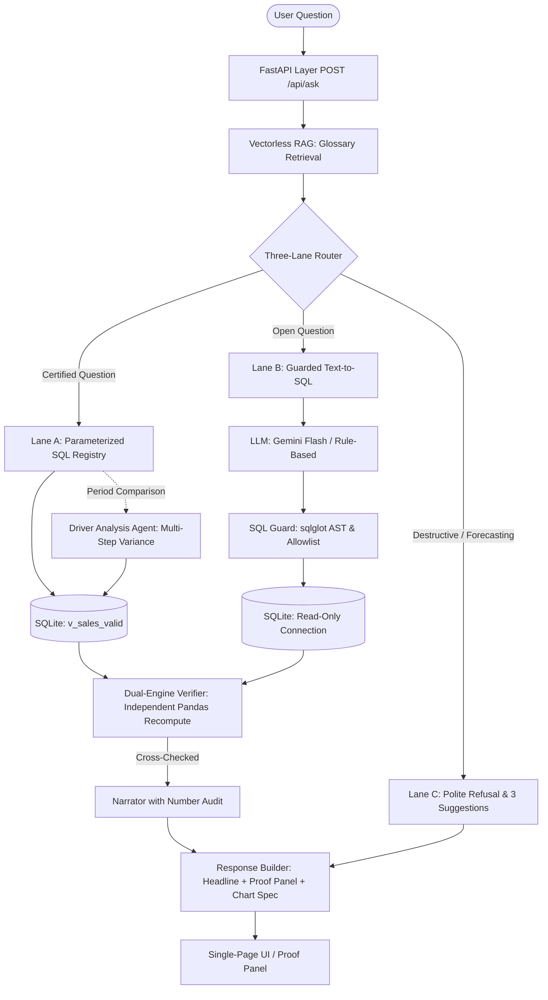

# Architecture: Ask-the-Numbers

"Ask in plain English. Get answers you can audit."

---

## 1. System Overview

Most Text-to-SQL submissions rely entirely on the LLM to write ad-hoc SQL, execute it blindly, and show the text response. If the LLM generates a subtly incorrect formula, hallucinated column, or wrong arithmetic, the user has no way to verify the figures.

**Ask-the-Numbers** operates on a fundamentally different reliability paradigm:
> **"The LLM never does the math. It only decides what to ask. Every number comes from a validated query, is cross-checked by a second independent engine, and is shown with its audit proof."**

---

## 2. The Three-Lane Router

1. **Lane A – Certified Metrics (Deterministic):**
   - Covers core executive metrics: Total Revenue, Top Product Ranking, Monthly Trend, Top Region, Period Comparison, AOV, Categories, Channels, Discounts, and Returns.
   - Executes parameterized SQL with bound parameters. Immune to prompt drift or hallucination.

2. **Lane B – Guarded Text-to-SQL:**
   - Handles novel open-ended filtering.
   - Guarded by `sqlglot` AST analysis: enforces single `SELECT` statement, validates table and column allowlists, blocks comments (`--`, `/* */`), prevents stacked semicolons, and enforces a 500-row cap.
   - Executed against a read-only SQLite connection.

3. **Lane C – Polite Refusal:**
   - Detects destructive attacks (`DROP`, `DELETE`, `PRAGMA`), system prompt extraction, or speculative forecasting ("predict next year's revenue").
   - Explains dataset boundaries (H1 2026) and offers 3 valid suggested alternatives.

---

## 3. Dual-Engine Verification (USP-3)

Every SQL query result in Lane A is independently recomputed via a separate, parallel Pandas pipeline loading the CSV directly.
- Both engines compute the metric independently (SQL engine vs Pandas engine).
- If values match within floating point tolerance (`abs_tol=0.01`), the response is granted the `✅ Verified by Dual-Engine (SQL + Pandas)` badge.
- If a discrepancy occurs, the response is blocked and flagged as unverified.

---

## 4. Multi-Step Driver Analysis Agent (USP-5)

When analyzing variance between periods (e.g. March vs April, May spike, June drop), a 4-step autonomous reasoning flow is triggered:
1. **Plan:** Defines period targets, baseline and comparison months, and decomposition targets.
2. **Query:** Executes SQL slices across Total Net Revenue, Product Deltas, Regional Deltas, and Sales Channel Shifts.
3. **Decompose:** Calculates absolute variance and percentage contribution per dimension.
4. **Narrate:** Synthesizes a structured business narrative flagging the top 2 positive drivers and primary offsetting drags.

---

## 5. Vectorless RAG (USP-6)

Instead of relying on vector databases (which introduce embedding drift, index latency, and opaque similarity thresholds for small structured domains), Ask-the-Numbers uses a hierarchical JSON glossary (`knowledge/glossary.json`):
- Term synonyms map deterministically to canonical business metrics (`sales`, `revenue`, `turnover` → `net_revenue`).
- Product aliases map directly to canonical inventory (`mouse` → `Wireless Mouse`).
- Zero API keys required; 100% auditable and reproducible.
