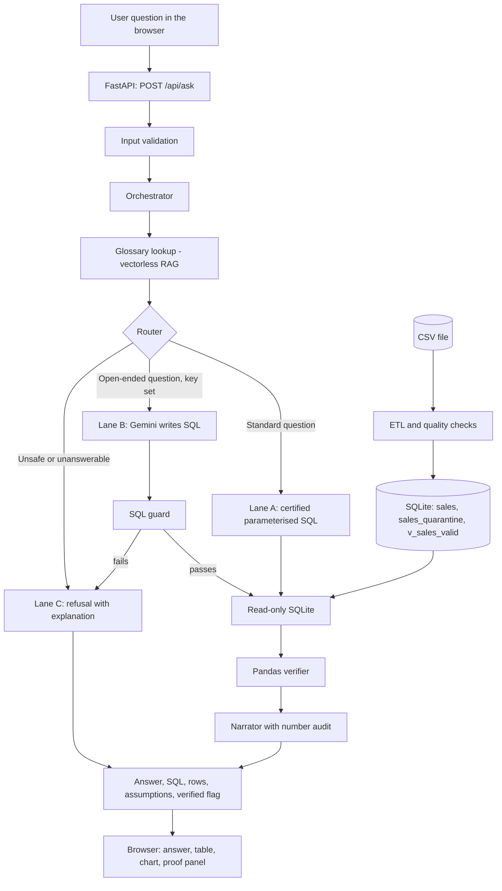
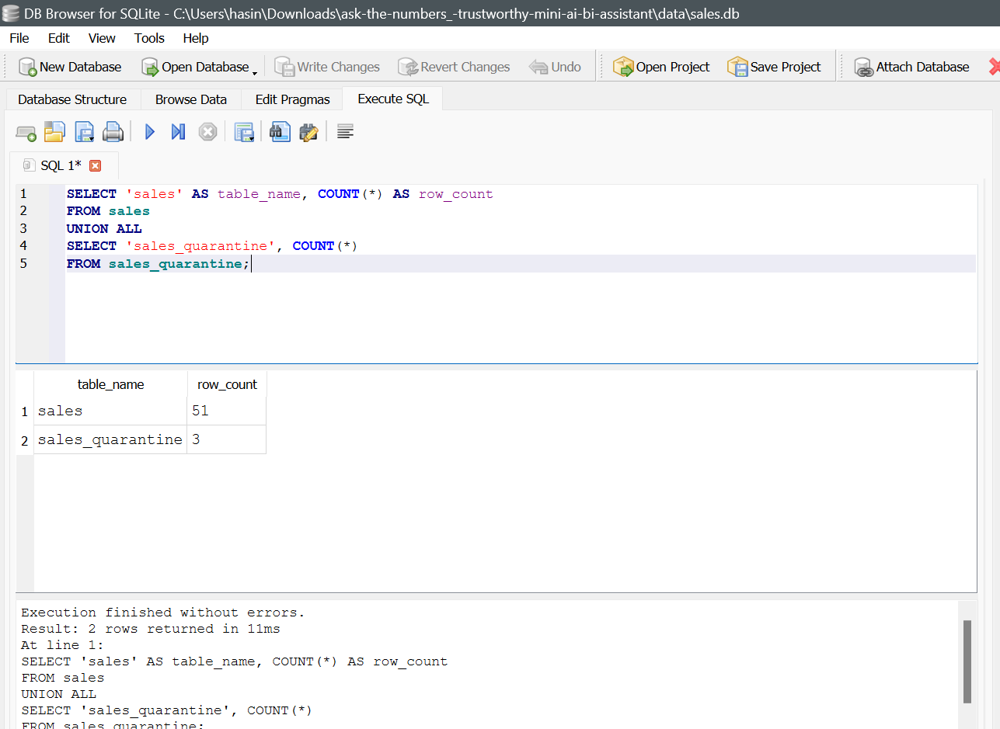
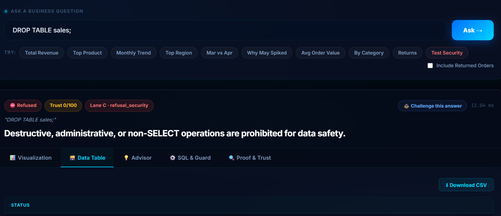

# Architecture

This document explains how Ask-the-Numbers works, why I built it this way, and where each part lives in the code.

## The idea in one paragraph

A business user asks a question in plain English. The app works out which question it is, runs a database query to get the numbers, checks those numbers a second way, and then shows the answer together with the query and the rows behind it. The AI helps with understanding the question and phrasing the answer. It is never the source of a number.

## Overview

## Data layer

**Source.** The file `data/ai_bi_assistant_sales_data_-_GET.csv` has 51 transactions between 3 January and 28 June 2026. It covers 7 products in 3 categories, 4 regions and 2 sales channels. Columns: Transaction_Id, Order_date, Product, Category, Region, Sales_channel, Quantity, Unit_price, Discount_amount, Status.

**Loading (`app/data/etl.py`).** At startup the loader:

1. Reads the CSV. If the file is missing, it stops with a clear error. It never creates data.
2. Parses `Order_date` explicitly as day-month-year (`%d-%m-%Y`). Without this, `03-01-2026` would be read as 1 March instead of 3 January. Dates are stored in ISO form, with a separate month column.
3. Loads all 51 rows into the `sales` table, then checks every row and records the ones that fail in the quarantine table with a reason.

**Tables and view**

| Name | What it holds |
|---|---|
| `sales` | All 51 loaded rows, nothing deleted |
| `sales_quarantine` | The 3 flagged rows, each with a reason |
| `v_sales_valid` | The view all analytics read from: the 48 rows that are completed, have a quantity above zero and have a unit price |

**Rows I set aside, and why**

| Transaction | Date | Problem | What I did |
|---|---|---|---|
| TXN0033 | 26-04-2026 | Status is Returned (Monitor, quantity 2, ₹19,000 before discount) | Excluded from revenue, reported separately as returns, can be included with an option |
| TXN0034 | 28-04-2026 | Quantity is 0 | Quarantined, because an order of zero units is not a real sale |
| TXN0051 | 28-06-2026 | Unit_price is missing (Laptop Stand, quantity 5) | Quarantined. I did not guess a price, because any guess would silently change June's revenue |

51 rows in, 3 flagged, 48 used. Nothing is dropped without a record.

**Revenue definition.** Net revenue = Quantity × Unit_price − Discount_amount, counted only for completed orders with a quantity above zero and a known price. On the 48 clean rows this gives ₹14,39,200. The file has no currency column, so I show amounts in rupees.

*The database: 51 rows in `sales` and 3 in `sales_quarantine`.*

## How a question is handled

1. **Validation.** The API checks the question is present and a sensible length. Bad input gets a clear error, not a crash.
2. **Glossary lookup.** The app looks up the words in the question (for example "sales", "turnover", "mouse") in a small glossary file and finds what they mean in this dataset. This is retrieval without embeddings, explained below.
3. **Routing.** The question goes to one of three lanes.
4. **Execution.** The query runs on a read-only SQLite connection.
5. **Verification.** The result is recomputed independently in Pandas.
6. **Narration.** The answer text is written and its numbers are audited.
7. **Response.** The browser receives the answer, the SQL, the rows, the assumptions and a verified flag.

## The three lanes

**Lane A, certified questions (`app/core/lane_a.py`).** For the standard questions (total revenue, top product, monthly trend, top region, change between months) I wrote the SQL myself with bound parameters. The AI only picks which question it is and fills in values such as the month names. This lane gives the same answer every time.

**Lane B, open-ended questions (`app/llm/gemini.py` and `app/core/guard.py`).** If a Gemini key is set and the question is not one of the standard ones, the model drafts a SQL query. The query is then validated before it can run (see the SQL guard below). If it fails validation, the app does not run it.

**Lane C, refusal.** Destructive requests, questions the data cannot answer and unrelated topics get an explanation and a few questions that can be answered.

## How wrong answers are prevented

| Risk | What stops it |
|---|---|
| The AI makes up a number | Numbers come only from SQL results, and the narrator's text is audited so every number it quotes appears in the result |
| The SQL is wrong | Standard questions use SQL I wrote and tested, and results are recomputed in Pandas before the Verified badge appears |
| Bad rows distort totals | Bad rows are quarantined, and queries read only from `v_sales_valid` |
| The AI writes harmful SQL | The SQL guard, a read-only connection and a row limit |
| The question cannot be answered | Lane C refuses and explains instead of guessing |
| The user cannot tell where a number came from | The proof panel shows the SQL, the formula, the assumptions and the row counts |

*A destructive request being refused.*

## SQL guard (`app/core/guard.py`)

Generated SQL is parsed with sqlglot and must pass all of these checks before it runs:

- Exactly one statement.
- The statement must be a SELECT (common table expressions are allowed).
- No INSERT, UPDATE, DELETE, DROP, ALTER, CREATE, ATTACH, PRAGMA or similar.
- No comments and no chained statements.
- Only the approved table and view and their columns. An unknown column, which is how a hallucination shows up, is rejected.

Even if something got through, the connection is read-only and results are limited to 500 rows.

## Verifier (`app/core/verifier.py`)

For the standard questions, the same figure is calculated a second way with Pandas on the clean data, and the two results must match. A mismatch blocks the answer. I tested this by deliberately corrupting a result and checking that it was caught. The check is strongest for the standard questions. For free-form SQL from Lane B, I can validate and show the query, but I cannot independently recompute every possible query.

## Narrator and number audit (`app/core/narrator.py`)

The narrator turns the result rows into a sentence. Before the sentence is shown, a check confirms that every number in it appears in the query result. If not, the app falls back to a plain template built straight from the rows.

## Driver analysis (`app/core/agent_drivers.py`)

For "How did revenue change between two months?", showing only the difference is not very useful. This part works in steps:

1. **Plan.** Work out the two months being compared.
2. **Query.** Get revenue for each month, overall and sliced by product, region and channel.
3. **Decompose.** Work out how much each product, region and channel contributed to the change.
4. **Narrate.** Write the explanation using only those computed figures.

For March to April, revenue rose ₹16,800 (+7.50%), driven mainly by Wireless Mouse and USB-C Hub. This is a small multi-step agent whose steps are fixed in code, so its behaviour is predictable.

## Vectorless RAG (`app/knowledge/glossary.json`, `app/core/vectorless_rag.py`)

Users say "sales", "revenue" or "turnover" and mean the same thing. The glossary holds the meaning of these terms, product synonyms, and the revenue definition. The app finds the relevant entries by structure and keyword matching instead of embeddings, and passes only those entries to the interpreter. I chose this because the glossary is tiny and exact: matching is easy to inspect and has no embedding model to maintain. With thousands of documents and fuzzy meaning, I would switch to vector search.

## LLM providers (`app/llm/`)

- `rule_based.py` works with no key, using keywords, synonyms and fuzzy matching. It is the default.
- `gemini.py` is used when `GEMINI_API_KEY` is set. The model name comes from `LLM_MODEL`.

Both follow the same interface, so a different model provider can be added as one new file. If the model call fails, the app falls back to the rule-based interpreter instead of showing an error.

## Trust score, challenge and Break-It demo

Every answer gets a trust score out of 100 with a breakdown: whether two engines agreed, whether a certified query was used, how many rows were quarantined, and whether any value was imputed. The Challenge button shows the answer under more than one definition. The Break-It Demo sends attack-style requests and shows that each is blocked. The Advisor tab keeps verified facts, risks and recommendations in separate columns, and recommendations are suggestions based on the figures, not measured results.

## Backend (`app/api/`, `app/main.py`)

FastAPI with Pydantic models for requests and responses. Errors use one consistent format and sensible status codes, and internal details are not exposed to the client.

## Frontend (`app/static/`)

A single page served by FastAPI at the root. It has a question box, example questions, the answer, and tabs for the table, chart, SQL and proof panel, plus a data quality view. Charts use Chart.js.

## Tests (`tests/`)

| File | What it covers |
|---|---|
| `test_etl.py` | Date parsing, quarantine rules, row counts, missing file error |
| `test_metrics_golden.py` | The verified figures: total, top product, top region, monthly series |
| `test_router.py` | Question interpretation |
| `test_guard_security.py` | Destructive SQL, injection attempts, unknown columns |
| `test_drivers.py` | Change between months and what drove it |
| `test_api.py` | Endpoints, responses, input limits, error handling |
| `test_new_features.py` | Trust score, challenge feature, Break-It demo, advisor, and their endpoints |
| `test_gemini_live.py` | Calls Gemini when a key is set, skipped otherwise |

The golden figures in the tests are re-derived with Pandas rather than copied from the app.

## How this relates to the topics in the brief

**Generative AI.** Gemini drafts SQL for open-ended questions and the narration is written by a language model or a template.

**Agentic AI.** The driver analysis plans, queries, decomposes and explains in several steps. The overall flow from routing to verification is also a multi-step pipeline.

**RAG and vectorless RAG.** The glossary lookup retrieves relevant definitions before interpretation, without embeddings.

**LangChain, Google ADK and Dify.** I wrote the core in plain Python so that I can explain every line. LangChain (and LangGraph) is a library for chaining model calls and tools and building stateful agent graphs. Google's Agent Development Kit is a code-first framework for building and deploying agents. Dify is a platform for building LLM apps with a visual workflow. The same pipeline could be expressed in any of them, but none was needed for this task.

## Design decisions

- **SQLite.** The dataset is tiny and read-only, so I needed no database server and the project runs anywhere.
- **Certified SQL first.** Reliability matters more than flexibility for the questions a business asks every day.
- **Quarantine instead of deleting or fixing.** I can always show exactly what was left out, and I never invented data.
- **Plain Python orchestration.** Easier to test, debug and explain than a framework.