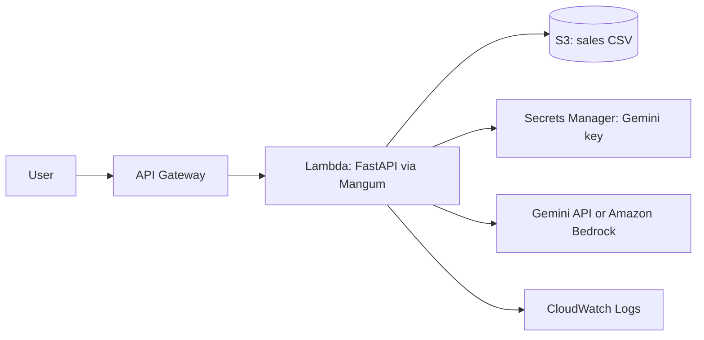

# AWS Deployment

## Where things stand

The application runs locally. The repository contains a Lambda entry point (`lambda_handler.py`, which wraps the FastAPI app with Mangum) and a `Dockerfile`. I have **not deployed it to AWS**. This document describes how I would, and why each service fits.

| Item | Status |
|---|---|
| Runs locally | Done |
| Lambda entry point | Written, not deployed |
| Dockerfile | Written |
| Loading the CSV from S3 | Not implemented, the app reads a local file |
| Bedrock as a model provider | Not implemented |

## How the pieces map to AWS

## Services and what each one does here

**S3** would hold the sales CSV. At startup the app would download it and build the SQLite database in memory or in `/tmp`, which is fine for a file this small. This needs a small change to the loader, because it currently reads from disk.

**Lambda with API Gateway** runs the API without a server to manage. Mangum translates API Gateway requests into the form FastAPI expects, so the same app code runs locally and on Lambda. Each Lambda instance builds its own copy of the database, which works because the data is read-only.

**Secrets Manager or Systems Manager Parameter Store** would hold the Gemini API key, so it is never in the code or the repository.

**Amazon Bedrock** is an alternative to calling Gemini. The model providers share one interface, so using Bedrock means adding one new provider file and giving the Lambda role permission to call it. This keeps requests inside AWS.

**SageMaker** would matter if I hosted my own model or trained one. This project uses hosted models, so I do not need it. I mention it because the role works with it, and I would reach for it if the data or the model grew into something custom.

**Amazon Lex** could be a chat front end, for example for a voice or messaging channel. Lex would hand the user's text to a Lambda that calls `POST /api/ask` and returns the answer.

**CloudWatch** collects logs and metrics from Lambda. I would watch error rates, response times and how often questions are refused.

**IAM** gives the Lambda role only the permissions it needs: read one S3 object, read one secret, write logs.

## Steps I would follow

1. Create an S3 bucket and upload the CSV.
2. Change the loader so it can read from S3 as well as from disk, chosen by an environment variable.
3. Store the Gemini key in Secrets Manager.
4. Package the app with its dependencies, or build the container image, and create the Lambda function.
5. Set `LLM_MODEL` and the S3 location as environment variables.
6. Create an API Gateway HTTP API that forwards all routes to the function.
7. Open the API URL, check the page loads, and ask the five example questions.
8. Check CloudWatch for errors.

## Things I would check before calling it production-ready

- Cold start time, because the database is built when an instance starts.
- Request limits and authentication on the API, because there are none yet.
- The size of the packaged dependencies against Lambda's limits. If it is too large, the container route is the alternative.
- Cost: Lambda and API Gateway charge per request, so an idle app costs almost nothing, but model calls would be the main cost.